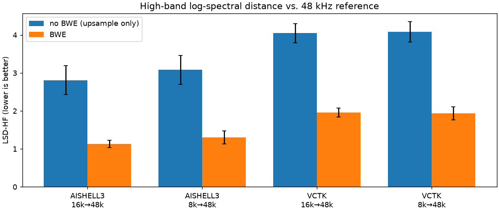
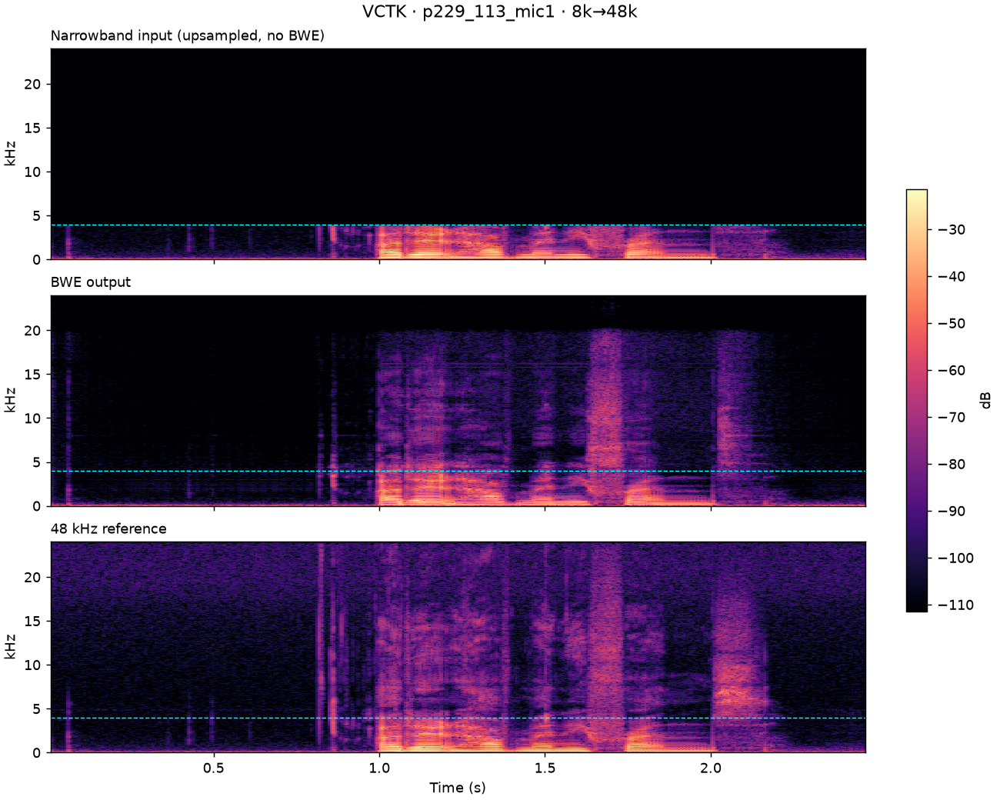
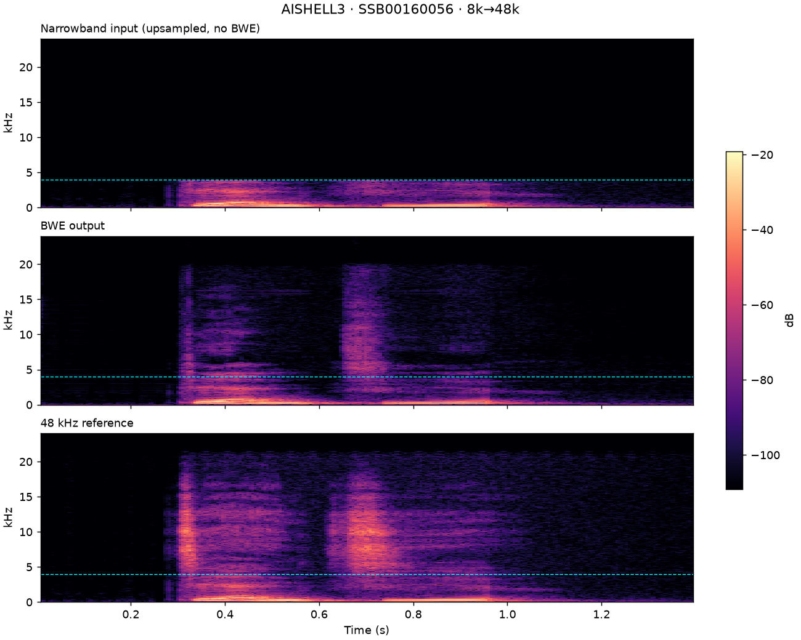

# Bandwidth Extension (BWE) Stream SDK — Results

Real-time, DNN-based audio **bandwidth extension** for embedded / mobile CPUs:
it reconstructs the missing high-frequency content of narrowband speech, turning
**8 kHz / 16 kHz** input into **48 kHz** wideband output, frame by frame, in a
streaming C library.

**This repository publishes results, not code.** It contains objective
evaluation numbers on two public corpora, spectrograms and before/after audio.
The implementation, model weights, binaries and tooling are proprietary and not
included.

## What it does

```
narrowband PCM (8 / 16 kHz) ──► analysis ──► neural high-band estimator
                             ──► synthesis ──► 48 kHz PCM
```

- **Streaming**: fixed 70 ms input frames, overlap-add output, no look-ahead
  beyond the frame.
- **No dynamic allocation** in the processing path: a single fixed workspace
  buffer, nothing is malloc'd afterwards.
- **Two modes**: `8k → 48k` and `16k → 48k`, selectable at init.
- **Portable C11 / C++14**: Windows x64 (MSVC), Linux arm64 (GCC, QEMU-tested),
  Android arm64 with NEON-optimised inference kernels.

## Listen

**▶ [Listening page](https://r7788380.github.io/bwe-stream-sdk-results/)**
([中文版](https://r7788380.github.io/bwe-stream-sdk-results/index.zh.html)) — every
clip below with an in-browser player, side by side with its spectrogram.

**Evaluation utterances** — the four utterances shown in the spectrograms, each
as 8 kHz / 16 kHz input, SDK output from both, and the 48 kHz reference
(`eval/listening/<corpus>/<stem>_{in8k,bwe_from8k,in16k,bwe_from16k,ref48k}.wav`):

| Utterance | Corpus | Files |
|---|---|---|
| p229_113 | VCTK (English) | [`eval/listening/VCTK/`](eval/listening/VCTK/) |
| p229_123 | VCTK (English) | [`eval/listening/VCTK/`](eval/listening/VCTK/) |
| SSB0016_0056 | AISHELL-3 (Mandarin) | [`eval/listening/AISHELL3/`](eval/listening/AISHELL3/) |
| SSB0016_0203 | AISHELL-3 (Mandarin) | [`eval/listening/AISHELL3/`](eval/listening/AISHELL3/) |

**Real-world clips** — Mandarin speech captured on a phone (no 48 kHz reference),
as narrowband input and as the SDK's 48 kHz output:

| File | Rate | Description |
|---|---|---|
| `samples/統神鼎王_8kHz.wav`, `samples/控八控控_8kHz.wav` | 8 kHz | Narrowband input |
| `samples/統神鼎王_16kHz.wav`, `samples/控八控控_16kHz.wav` | 16 kHz | Narrowband input |
| `samples/*_48k_from_8k.wav` | 48 kHz | Extended from the 8 kHz input |
| `samples/*_48k_from_16k.wav` | 48 kHz | Extended from the 16 kHz input |

## Objective evaluation

Scored against 48 kHz references on two public corpora — **VCTK** (English,
30 speakers × 10 utterances, gender-balanced) and **AISHELL-3** (Mandarin, 30
speakers × 10 utterances). Each reference is RMS-normalised to −26 dBFS,
band-limited to 8 kHz / 16 kHz with soxr, run through the SDK, aligned, and
compared with the original. **"no BWE"** is the same narrowband input simply
upsampled back to 48 kHz, so every row shows the gain over doing nothing.

| Corpus | Mode | LSD ↓ no BWE → **BWE** | LSD-HF ↓ no BWE → **BWE** |
|---|---|---|---|
| VCTK | 8k→48k | 3.74 → **1.80** | 4.08 → **1.94** |
| VCTK | 16k→48k | 3.33 → **1.67** | 4.05 → **1.96** |
| AISHELL-3 | 8k→48k | 2.83 → **1.23** | 3.08 → **1.31** |
| AISHELL-3 | 16k→48k | 2.33 → **1.03** | 2.81 → **1.13** |

LSD = log-spectral distance (STFT 2048/512, same convention as the NU-Wave /
AP-BWE reference code); LSD-HF restricts it to the reconstructed band above the
input Nyquist. Full table with std, LSD-LF and SNR: [`eval/results/summary.md`](eval/results/summary.md).



The high band is reconstructed from nothing — fricatives and plosives come back
where the input has only silence above the cyan line:

| VCTK · p229_113 · 8k→48k | AISHELL-3 · SSB0016_0056 · 8k→48k |
|---|---|
|  |  |

## Runtime

Each frame covers **70 ms** of input audio, so anything well under 70 ms per
frame is real time.

Single core, release build, average over repeated frames. MCPS (million cycles
per second) is reported only where the CPU clock could be locked.

| Platform | 8k→48k avg / frame | 16k→48k avg / frame | MCPS (8k / 16k) | Real-time factor (8k) |
|---|---|---|---|---|
| AMD Ryzen 5 5600G @ 3.9 GHz (x64) | 3.70 ms | 3.50 ms | 206 / 195 | 0.053 |
| Apple Silicon (arm64) | 1.9 – 3.8 ms | 1.9 – 3.9 ms | – | 0.03 – 0.05 |
| Google Pixel 9 (locked clock) | 2.32 ms | 2.29 ms | 130 / 128 | 0.033 |
| Google Pixel 4 (locked clock) | 5.95 ms | 4.68 ms | 333 / 262 | 0.085 |
| Xiaomi 13 | 2.91 ms | 2.87 ms | – | 0.042 |
| Xiaomi 12 Pro | 4.60 ms | 4.55 ms | – | 0.066 |
| Xiaomi 11 Pro | 3.57 ms | 3.54 ms | – | 0.051 |
| OPPO Find X3 Pro | 4.83 ms | 4.77 ms | – | 0.069 |

Real-time factor = processing time ÷ 70 ms of audio per frame; 1.0 would be the
limit for real time. Retail phones cannot lock the CPU clock, so their MCPS is
not reported and their timings vary with the governor.

### Footprint

| | 8k→48k | 16k→48k |
|---|---|---|
| Code (`.text`) | 67.6 KB | 67.6 KB |
| Constant data incl. model weights (`.rdata`) | 1,477 KB | 1,477 KB |
| Working RAM (workspace, statically sized) | 977 KB | 977 KB |
| MACs per 70 ms frame | 5.41 M | 5.09 M |

Both modes share the same code image and network architecture; the 8k path only
adds an extra up-sampling stage in front of it. At 5.41 M MACs per 70 ms frame the compute load is
≈ 77 M MAC/s, which is what keeps a single mobile core at a few percent
utilisation.

## License

Sample audio and evaluation results are provided for **evaluation only**; see
[`LICENSE`](LICENSE). Third-party components used by
the library are listed in [`THIRD_PARTY_LICENSES.md`](THIRD_PARTY_LICENSES.md).
Corpus attributions: VCTK (CC BY 4.0, University of Edinburgh), AISHELL-3
(Apache-2.0, AISHELL Foundation).
